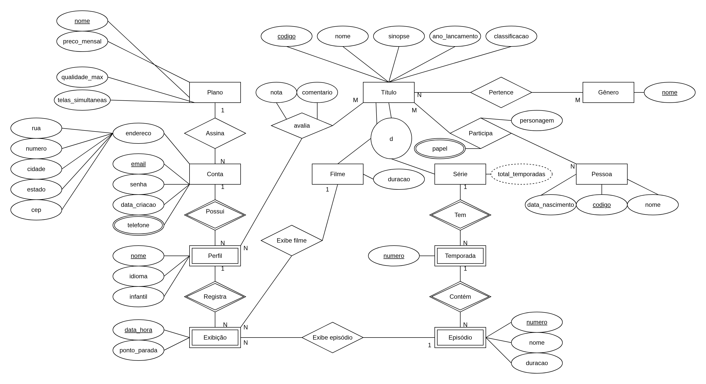

# Plataforma de streaming - projeto de Banco de Dados

IMD0401 Banco de Dados, turma T02, 2026.2 (UFRN/IMD). Professor: Gustavo Alves Bezerra.

Grupo: Jorge do Amaral Neto, Lucas de Medeiros Galvão Pereira e José Ricardo Pereira Leiros Cunha.

## 1. Minimundo

O banco é de uma plataforma de streaming de vídeo. Cada conta é identificada pelo e-mail, assina um plano e pode ter de 1 a 5 perfis. O catálogo tem títulos, que são filmes ou séries, e as séries têm temporadas e episódios. Também guardamos as pessoas que participam das produções (diretor, roteirista, ator), as exibições de cada perfil com o ponto onde parou e as avaliações de 1 a 5 que os perfis dão aos títulos.

O texto completo está em [docs/minimundo.md](docs/minimundo.md).

## 2. Diagrama Entidade-Relacionamento



Fizemos o DER na notação de Chen no draw.io ([docs/der.drawio](docs/der.drawio)). Entidades fracas e relacionamentos identificadores estão com borda dupla.

Ele tem as entidades fracas Perfil, Temporada, Episódio e Exibição, a especialização total e disjunta de Título em Filme e Série, o atributo multivalorado telefone, o composto endereço e o derivado total de temporadas, além de dois relacionamentos N:M com atributos: Avalia (nota e comentário) e Participa (papel e personagem).

## 3. Modelo lógico

As tabelas são criadas em [db/01_schema.sql](db/01_schema.sql). Cada uma tem um `COMMENT ON TABLE` dizendo de que parte do DER ela veio.

| Tabela | Chave primária | Origem no DER |
|---|---|---|
| plano | nome | entidade Plano |
| conta | email | entidade Conta; endereço vira colunas; FK plano_nome = relacionamento Assina |
| conta_telefone | conta_email, telefone | atributo multivalorado telefone |
| perfil | conta_email, nome | entidade fraca Perfil (Possui) |
| titulo | codigo | entidade Titulo, superclasse da especialização |
| filme | titulo_codigo | subclasse Filme; FK (titulo_codigo, tipo) com tipo fixo em F |
| serie | titulo_codigo | subclasse Serie; FK (titulo_codigo, tipo) com tipo fixo em S |
| temporada | serie_codigo, numero | entidade fraca Temporada (Tem) |
| episodio | serie_codigo, temporada_numero, numero | entidade fraca Episodio (Contem) |
| genero | nome | entidade Genero |
| titulo_genero | titulo_codigo, genero_nome | relacionamento N:M Pertence |
| pessoa | codigo | entidade Pessoa |
| participacao | pessoa_codigo, titulo_codigo, papel | relacionamento N:M Participa; papel entra na chave |
| avaliacao | conta_email, perfil_nome, titulo_codigo | relacionamento N:M Avalia (nota, comentario) |
| exibicao | conta_email, perfil_nome, data_hora | entidade fraca Exibicao (Registra); FKs de Exibe filme e Exibe episodio |

As entidades fracas usam `ON DELETE CASCADE`: se apagar uma conta, os perfis vão junto, e se apagar um perfil, as exibições e avaliações dele também.

Em [db/02_views.sql](db/02_views.sql) ficam três views:

- `v_serie_temporadas`: total de temporadas de cada série (o atributo derivado do DER)
- `v_titulo_avaliacao`: média de nota e quantidade de avaliações de cada título
- `v_continuar_assistindo`: última exibição de cada filme ou episódio por perfil, com o ponto de parada

## 4. Como criar e popular o banco

Precisa de Docker com Docker Compose. Python 3.11 ou mais novo só é necessário para o app.

```bash
cp .env.example .env
docker compose up -d
docker compose logs postgres
```

Na primeira subida o PostgreSQL roda os arquivos de `db/` em ordem alfabética (por isso os prefixos 01, 02 e 03: tabelas, views e dados). No log tem que aparecer `running /docker-entrypoint-initdb.d/01_schema.sql` e os outros dois, sem nenhum `ERROR`. A pasta `db/queries` não é executada nessa hora.

Se a porta 5432 já estiver ocupada, é só trocar `POSTGRES_PORT` no `.env`.

Os scripts só rodam com o volume vazio. Para recriar o banco do zero:

```bash
docker compose down -v
docker compose up -d
```

Para abrir o psql dentro do container (usuário e banco do `.env.example`):

```bash
docker compose exec postgres psql -U streaming -d streaming
```

## 5. Exemplos de utilização

As consultas estão em [db/queries](db/queries), uma por arquivo. No começo de cada arquivo tem a pergunta, os recursos de SQL usados e um valor de exemplo para cada parâmetro.

| Arquivo | Pergunta | Recursos de SQL |
|---|---|---|
| 01_titulos_mais_bem_avaliados.sql | Quais títulos têm a maior média de nota, com pelo menos 2 avaliações? | JOIN, GROUP BY, HAVING, AVG, ORDER BY |
| 02_continuar_assistindo.sql | O que um perfil parou de ver no meio e em que minuto? | view, CTE e ROW_NUMBER (na view), parâmetros |
| 03_elenco_e_equipe_do_titulo.sql | Quem participou de um título, com qual papel e personagem? | JOIN de três tabelas, ORDER BY com CASE |
| 04_series_com_mais_episodios.sql | Quais séries têm mais episódios? | JOIN com view, LEFT JOIN, COUNT, SUM |
| 05_contas_por_plano.sql | Quantas contas e qual a receita mensal de cada plano? | LEFT JOIN, GROUP BY, expressão com agregação |
| 06_generos_mais_assistidos.sql | Quais gêneros têm mais exibições? | JOIN com COALESCE, COUNT(DISTINCT) |
| 07_perfis_infantis_fora_da_classificacao.sql | Quais perfis infantis viram títulos acima de 12 anos? | JOIN de três tabelas, WHERE com IN e booleano |
| 08_pessoas_com_mais_de_um_papel.sql | Quem teve mais de um papel no mesmo título? | GROUP BY, HAVING, STRING_AGG |
| 09_titulos_sem_avaliacao.sql | Quais títulos nunca foram avaliados? | subconsulta correlacionada com NOT EXISTS |
| 10_historico_do_perfil.sql | Quais as exibições de um perfil em ordem cronológica? | vários LEFT JOIN, CASE, concatenação |

Como a pasta `db/` está montada no container, as consultas sem parâmetro rodam direto no psql com `\i`:

```
\i /docker-entrypoint-initdb.d/queries/01_titulos_mais_bem_avaliados.sql
```

As consultas 02, 03 e 10 usam parâmetros no formato do psycopg (`%(email)s`, `%(perfil)s`, `%(codigo)s`). Para rodar no psql tem que trocar pelos valores, por exemplo:

```bash
sed "s/%(email)s/'ana.souza@email.com'/; s/%(perfil)s/'Lia'/" db/queries/02_continuar_assistindo.sql \
  | docker compose exec -T postgres psql -U streaming -d streaming
```

### Aplicação

```bash
python3 -m venv .venv
source .venv/bin/activate
pip install -r requirements.txt
streamlit run app/main.py
```

O app é em Streamlit com psycopg 3. Não tem SQL escrito no Python: ele lê os mesmos arquivos de `db/queries`, e o que é usado só pela interface fica em `db/queries/app`. São quatro páginas:

- Catálogo: lista os títulos com a média de avaliação, com filtro por tipo e gênero
- Consultas: as 10 consultas da tabela acima; escolhe a consulta, preenche os parâmetros e vê o resultado e o SQL
- Meu perfil: o que o perfil deixou pela metade e as avaliações dele
- Avaliar: insere avaliações e exibições e mostra o erro do banco quando alguma restrição é violada (por exemplo, avaliar o mesmo título duas vezes)

## 6. Mudanças da iteração 1 para a 2

O DER conceitual continua o mesmo. O que mudou foi na passagem para o modelo lógico:

- Exibição de filme ou episódio: a tabela exibicao tem duas FKs opcionais, uma para filme e outra para episodio, e uma CHECK que obriga exatamente uma delas a estar preenchida. A FK do episódio usa `MATCH FULL`, então série, temporada e número do episódio vêm todos juntos ou ficam todos nulos.
- Coluna tipo em titulo: cada título tem tipo `F` ou `S`. Filme e serie também têm uma coluna tipo, fixa em `F` e `S` por CHECK, e a FK delas é (titulo_codigo, tipo) apontando para (codigo, tipo) de titulo. Com isso um título marcado como série não consegue ter linha em filme, e vice-versa, o que garante a disjunção. Também ajuda nas consultas, porque dá pra saber se é filme ou série sem olhar as subtabelas.
- Papel na chave de participacao: o atributo multivalorado papel entrou na chave primária, então cada papel de uma pessoa num título é uma linha. Uma CHECK garante que só ator tem personagem.
- total_temporadas virou view: o atributo derivado não é guardado, a view `v_serie_temporadas` calcula a partir das temporadas cadastradas. Assim ele nunca fica desatualizado.
- Endereço em colunas: o atributo composto endereço virou as colunas rua, numero, cidade, estado e cep em conta.
- Telefone em tabela própria: o atributo multivalorado telefone virou a tabela conta_telefone, uma linha por telefone.
- Regras que o schema não garante: o limite de 5 perfis por conta e a totalidade da especialização (todo título ter linha em filme ou em serie) ainda não são garantidos pelo banco. A ideia é tratar isso com trigger na próxima iteração ou no app.

## 7. Estrutura do repositório

```
docker-compose.yml     PostgreSQL 16, sobe com o banco criado e populado
.env.example           variáveis de conexão (copiar para .env)
requirements.txt       dependências do app
db/01_schema.sql       tabelas
db/02_views.sql        views
db/03_seed.sql         dados de exemplo
db/queries/            as 10 consultas
db/queries/app/        consultas e inserts usados só pelo app
app/main.py            telas do Streamlit
app/db.py              conexão, leitura dos .sql e execução
docs/minimundo.md      minimundo
docs/der.png           DER
docs/der.drawio        DER editável
docs/prints/           prints do app
```
